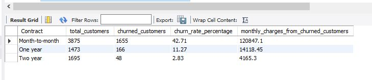

# Customer Churn Analysis Using MySQL

## Project Overview
This project analyzes customer churn for a telecommunications company using MySQL. The goal is to identify customer patterns and understand which factors are associated with customers leaving the service.

## Objectives
- Analyze overall customer churn and churn rate.
- Compare churn across contract types.
- Investigate churn by customer tenure.
- Examine churn patterns by monthly charges.
- Identify missing values and data-quality issues.
- Use SQL queries to derive business insights.

## Dataset
- **Dataset:** Telco Customer Churn
- **Total records:** 7,043 customers
- **Key columns:** CustomerID, gender, tenure, Contract, MonthlyCharges, TotalCharges, Churn

## Tools Used
- MySQL Workbench
- Visual Studio Code (VS Code)
- Git
- GitHub

## Project Structure
```text
customer-churn-analysis-sql/
├── Dataset/
│   └── WA_Fn-UseC_-Telco-Customer-Churn.csv
├── sql/
│   ├── 01_create_database_tables.sql
│   ├── 02_data_quality_checks.sql
│   ├── 03_churn_analysis.sql
│   └── 04_data_cleaning.sql
├── screenshots/
├── .gitignore
└── README.md
```

## SQL Skills Demonstrated
- Database and table creation
- Data-quality validation
- Aggregate functions: COUNT and SUM
- GROUP BY and ORDER BY
- CASE expressions and conditional aggregation
- Percentage calculations
- NULL-value checks
- Data cleaning and string handling

## Data Quality Findings
- Loaded and verified 7,043 customer records.
- Checked customer IDs for duplicates and missing values.
- Identified 11 missing TotalCharges values.
- Detected a carriage-return character affecting some Churn values and accounted for it in analysis queries.

## Analysis Performed
1. Overall churn distribution and churn rate.
2. Churn by contract type.
3. Churn by tenure group.
4. Churn by monthly charge group.

## Business Insights

### Key Findings

1. **Month-to-month contracts have the highest churn rate.** Of 3,875 customers in this group, 1,655 churned, resulting in a churn rate of 42.71%.

2. **Longer-term contracts have lower churn rates.** One-year contracts recorded an 11.27% churn rate, while two-year contracts recorded 2.83%.

3. **Monthly charges associated with churned customers are highest in the month-to-month segment.** The sum of monthly charges for churned customers in this group was 120,847.10.

### Recommendations

- Investigate the reasons month-to-month customers leave, such as pricing, service quality, and customer support.
- Test targeted retention offers or incentives for eligible month-to-month customers.
- Evaluate whether longer-term contract options appeal to customers who are considering leaving.
- Monitor churn rate and retention outcomes after implementing any changes.

*Note: These findings describe associations in the dataset and do not prove that contract type causes churn. Monthly charges associated with churned customers are not the same as confirmed lost revenue or profit.*

## Business Insights
The findings from the analysis will help identify customer segments with higher churn rates and support recommendations for improving customer retention.

## How to Run
1. Install MySQL and MySQL Workbench.
2. Create or select the `customer_churn_analysis` database.
3. Import the Telco Customer Churn CSV into `customer_churn_analysis_raw`.
4. Run the SQL scripts in the `sql/` folder in numerical order.
5. Review the result grids to understand the churn patterns.

## 📸 Project Screenshots

### Customer Churn by Contract

This analysis compares customer churn across month-to-month, one-year, and two-year contracts. Month-to-month customers have the highest churn rate.




## Author
Padmavathi Koduru

